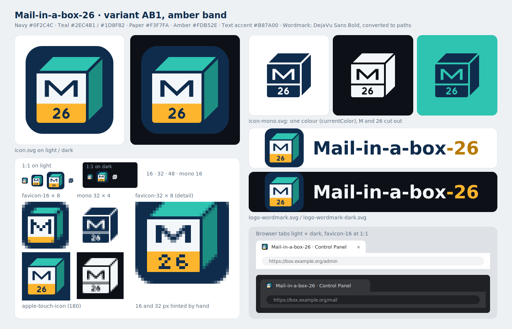

# Mail-in-a-box-26 branding

Logo and favicons of this fork (variant AB1, amber band). A cube in oblique
view on a navy tile: teal lid, darker teal side, and a paper front with an
"M" whose deep middle V is the flap of an envelope, above an amber label band
with "26".

## Files

| File | Use |
| --- | --- |
| `icon.svg` | Master icon, 512 × 512 viewBox, colour, with tile |
| `icon-mono.svg` | One colour (`currentColor`), no tile; M and 26 are cut out |
| `logo-wordmark.svg` | Icon + "Mail-in-a-box-26" for light backgrounds |
| `logo-wordmark-dark.svg` | The same for dark backgrounds |
| `favicon.ico` | 16, 32 and 48 px |
| `favicon-16.png`, `favicon-32.png` | Hinted by hand, pixel by pixel; not downscaled from the master |
| `apple-touch-icon.png` | 180 × 180, opaque, square corners (iOS rounds them) |
| `social-preview.png` | 1280 × 640, GitHub social preview |
| `preview.png` | Overview sheet (not used anywhere) |
| `build.py` | Generates all of the above |

## Colours

| Name | Hex | Where |
| --- | --- | --- |
| Navy | `#0F2C4C` | Tile, M, digits, wordmark text on light |
| Teal | `#2EC4B1` | Lid |
| Teal dark | `#1D8F82` | Side face |
| Paper | `#F3F7FA` | Front, wordmark text on dark |
| Amber | `#FDB52E` | Label band; "-26" in the dark wordmark |
| Amber dark | `#B87A00` | "-26" in the light wordmark (3.6:1, large bold text only) |

The digits on the band are navy on amber (contrast 8:1).

## Usage

* Use the files as they are. Do not recolour, stretch, rotate or redraw the
  icon, and do not set the wordmark again in another font.
* Small sizes: use `favicon-16.png` / `favicon-32.png` (or `favicon.ico`), not
  a scaled `icon.svg`. At 16 px the band is a plain stripe without "26".
* Light background: `logo-wordmark.svg`; dark background:
  `logo-wordmark-dark.svg`. For a single colour (print, embossing, a one-colour
  UI), use `icon-mono.svg`.
* Leave some free space around the icon, at least a tenth of its width.
* The logo marks this fork. It is not the logo of upstream Mail-in-a-Box and
  must not be used in a way that suggests the upstream project made or
  endorses something.

## Where the fork uses it

* Control panel: `setup/management.sh` copies the favicons and `icon.svg` to
  `/usr/local/lib/mailinabox/vendor/assets/branding/`, which nginx serves as
  `/admin/assets/branding/`; `management/templates/index.html` links them and
  shows the icon next to the box name in the navigation bar.
* Roundcube and Nextcloud: `setup/webmail.sh` sets the favicon of the Elastic
  skin (option `skin_logo`), `setup/nextcloud.sh` the favicon of the theming
  app; an own favicon of the operator is kept, and `FAVICON=off` in
  `/etc/mailinabox.conf` turns both off (see README-fork.md, "Favicons").
* Web domains of the box: `/favicon.ico` falls back to the fork's icon when the
  domain's web root has no `favicon.ico` of its own (`conf/nginx-alldomains.conf`).
* `conf/www_default.html`, the page a new box shows on its web domains.
* The header of the repository's `README.md`.
* GitHub social preview: `social-preview.png`, uploaded by hand in the
  repository settings (Settings > General > Social preview); the GitHub API
  cannot set it.

## Rebuilding

The generated files are committed, so `build.py` is only needed after a change
to the geometry or the colours. It runs from any directory and writes next to
itself (or into the directory given as its argument):

    uvx --with pillow --with fonttools --with skia-pathops --from cairosvg \
        python branding/build.py

It needs the DejaVu fonts (`fonts-dejavu-core` on Debian/Ubuntu; set
`DEJAVU_DIR` if they are elsewhere) and the Cairo library (`libcairo2`).

## Font

The wordmark and the social preview use DejaVu Sans Bold (subtitle: DejaVu
Sans), converted to paths, so no font file is needed to display them. The
DejaVu fonts are under the Bitstream Vera / DejaVu licence, which allows
embedding and redistribution. The icon itself contains no font: the M and the
26 are own geometry.

## Licence

Designed for this project; no artwork of Mail-in-a-Box, Ubuntu/Canonical or
any other brand was used. The logo files and `build.py` are dedicated to the
public domain under [CC0 1.0](https://creativecommons.org/publicdomain/zero/1.0/),
like the project itself.
